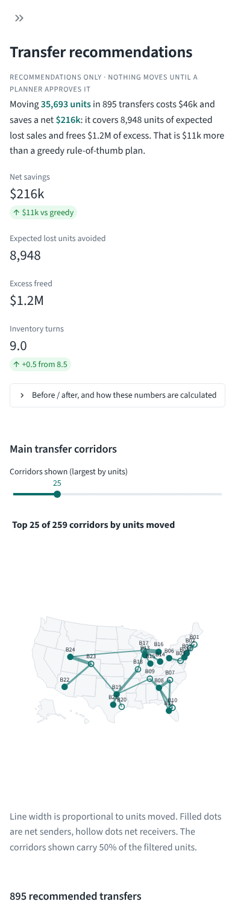
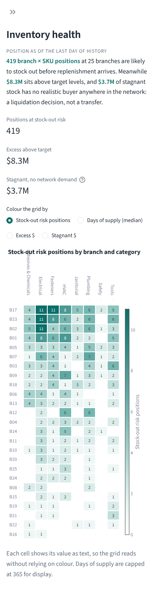
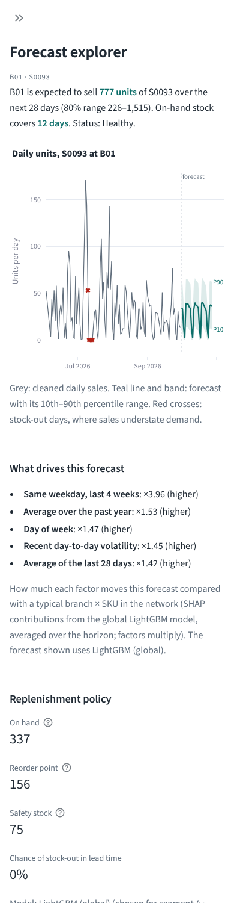
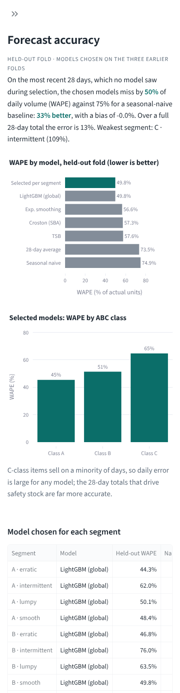

# Audit: Stockflow forecasting and rebalancing

**Scope:** the full repository as first built (v1, commit `f0ab18e`). Every finding cites
the v1 file and line where the problem was. Line numbers in the current code differ
because of the fixes and a `black` reformat.

**Method:**
- Code review of every module.
- End-to-end profiling at 1x and 10x scale.
- `pytest --cov`, `ruff`, `mypy`, `bandit` and `pip-audit`.
- Contrast measurements against WCAG 2.1.
- Screenshots at laptop (1366 px) and phone (390 px) widths.

**Severity:**

| Level | Meaning |
|---|---|
| critical | Breaks the system or makes results wrong at the required scale |
| high | Materially wrong, unsafe or unusable for the stated purpose |
| medium | Real weakness with a workaround or limited blast radius |
| low | Polish |

**Policy:** every critical and high item is fixed. Medium and low items are fixed where
cheap, otherwise deferred with a reason.

| | critical | high | medium | low | total |
|---|---|---|---|---|---|
| Found | 4 | 22 | 35 | 8 | 69 |
| Fixed | 4 | 22 | 29 | 3 | 58 |
| Deferred / accepted | 0 | 0 | 6 | 5 | 11 |

---

## Before / after summary

All "after" numbers are from the final code; "before" is v1 (`f0ab18e`). Forecast metrics are
compared on **identical data**: v1 was re-run from a worktree on the same generated extract.
Machine: 4 vCPU, 15 GB RAM.

**Pipeline runtime and peak memory**

| Stage | 1x before | 1x after | 10x before | 10x after |
|---|---|---|---|---|
| generate | 17.0 s / 1.1 GB | 9.4 s / 0.6 GB | crash: 25-city limit; when patched, `MemoryError` (4 GB alloc) at 8.4 GB after 37 s | 384 s / 6.5 GB |
| prep | 26.3 s / 2.0 GB | 21.3 s / 1.1 GB | not reachable (> 40 GB of dense matrices) | 2,324 s / 5.9 GB |
| forecast | 257.7 s / 2.1 GB | 242.8 s / 2.2 GB | not reachable (263M training rows) | 5,827 s / 9.5 GB; ≈ 3,800 s projected with the SHAP cap (P15) |
| policy | 1.4 s / 0.2 GB | 1.4 s / 0.3 GB | n/a | 30 s / 3.9 GB |
| optimize | 16.6 s / 0.4 GB | 15.2 s / 0.5 GB | n/a | 785 s / 2.0 GB (163 parallel batches, all optimal) |
| **total** | **319 s** | **290 s** | **fails** | **≈ 2.6 h measured (≈ 2.0 h with the SHAP cap)** |

Re-measured in the final review on the final code: generate 472 s, prep 3,103 s, forecast 4,109 s (peak 10.2 GB), policy 36 s, optimize 855 s, for 2.4 h in total; see [FINAL_REVIEW.md](FINAL_REVIEW.md).

10x = 250 branches × 3,000 SKUs = 487,747 series × 1,096 days (535M series-days).
The 10x prep and forecast stages shared the CPU with other work during measurement, so
those two figures are upper bounds.

**Forecast accuracy** (held-out fold 4, uncensored days, same data)

| Metric | Before | After |
|---|---|---|
| Accuracy figure reported | 50.0% WAPE, in-sample selection over 4 folds (optimistic by design) | 49.8% WAPE, selection on folds 1–3, scored on untouched fold 4 |
| LightGBM WAPE | 49.9% | 49.7% |
| LightGBM MASE | 0.758 | 0.723 |
| Bias (selected) | −0.7% | −0.8% |
| 28-day-total WAPE | 12.8% | 12.9% |
| P10–P90 coverage (target 80%) | 83.8% | 83.9% |
| Seasonal-naive WAPE | 74.9% | 74.9% |
| 10x held-out WAPE (LightGBM on ≤ 4M sampled rows) | n/a | 50.8% |

The leakage fix (D1) and the nested evaluation (D2) barely move accuracy on this data.
The look-ahead touched < 1% of days, and LightGBM wins almost every segment either way.
The honest number is now what gets reported.

**Optimiser** (1x)

| Metric | Before | After |
|---|---|---|
| Net savings | $207.7k | $203.1k |
| Greedy baseline | n/a | $192.7k |

The 2.2% lower savings are mainly arc pruning (0.8% when measured in isolation), the
price of making 10x solvable. At 10x the MILP saves $42.8M vs $40.6M for greedy, with zero
constraint violations.

**Quality gates**

| Gate | Before | After |
|---|---|---|
| Tests | 33 | 62 (unit + end-to-end + dashboard render) |
| Coverage | 39% | 94% |
| ruff | 86 issues | 0 |
| mypy | 34 errors (another 71 hidden by the local tool) | 0 |
| bandit | 4 low | 0 |
| pip-audit | 0 known vulnerabilities | 0 |
| Secrets in git history | none | none |
| CI | none | green: <https://github.com/bbbiyeba/stockflow/actions> |

**Screenshots after the UI pass** (laptop 1366 px; phone 390 px):

| Page | Laptop | Phone |
|---|---|---|
| Transfer recommendations |  |  |
| Inventory health |  |  |
| Forecast explorer |  |  |
| Forecast accuracy |  |  |

---

## 1. UI/UX

**Already true in v1, verified again:**
- No emoji, gradients, glass or neon.
- One palette, defined once in `src/ui_theme.py` and mirrored in `.streamlit/config.toml`: neutrals, one teal accent, red/amber/green for status only.
- One typeface (Source Sans).
- Business labels ("Days of supply", "Excess $").
- Units on chart axes and a consistent $1.2M / 4.3% number format.
- No pie or 3D charts.
- Each page opens with the decision it supports.

| ID | Finding | Location (v1) | Sev. | Status |
|---|---|---|---|---|
| U1 | The flow map drew all 886 transfers as lines, an unreadable hairball that hid the main corridors. | `app.py:352` | high | **Fixed**: shows the top *N* corridors (slider, default 25) and states the share of units they carry; filled vs hollow markers distinguish net senders without relying on colour. |
| U2 | Tables were sent to the browser unpaginated: up to 4.9k rows at 1x and ~490k at 10x. | `app.py:292`, `:362` | high | **Fixed**: 200-row pages, key columns pinned, CSV export of all filtered rows. |
| U3 | Non-selected bars used `#9aa5b1`, 2.5:1 against white, below WCAG 1.4.11's 3:1 for graphical objects. | `src/ui_theme.py:14` | high | **Fixed**: `#838d99`, 3.4:1. Text colours measured 5.2–14.8:1; status colours ≥ 5.1:1. |
| U4 | The accuracy headline quoted in-sample selection metrics, so it was optimistic (see D2). | `app.py:174` | high | **Fixed**: leads with the held-out fold; segments where the model doesn't beat naive raise a warning, and ties are labelled as ties. |
| U5 | The heatmap title overlapped the category labels. | `app.py:273` | medium | **Fixed**. |
| U6 | Bar labels were clipped ("74."), and the grouped ABC chart labelled bars inline ambiguously. | `app.py:186`, `:196` | medium | **Fixed**: axis headroom; single-series chart with direct value labels. |
| U7 | Jargon in labels ("Series-folds", unexplained MASE). | `app.py:208` | medium | **Fixed**: removed / help text added. |
| U8 | No indication of which run or role the user is looking at. | `app.py:403` | medium | **Fixed**: sidebar footer shows run id, sign-in state, role and masking. |
| U9 | Plotly charts are canvas/SVG without alt text. | all charts | medium | **Partly fixed**: every chart has a title and a one-line caption stating its message, heatmap cells print their values, and the same data is in sortable tables and CSVs. Deferred: per-element ARIA; Streamlit's Plotly wrapper does not expose it. Next step: render key charts through `st.components` with an `aria-label` and a hidden data table, or move to Vega-Lite, which supports ARIA descriptions. |
| U10 | One colour constant lived outside the theme file. | `app.py:239` | low | **Fixed**. |
| U11 | Forecast drivers (added during the audit) at first read "raises by 296%" without saying compared to what. | `src/dashboard.py` | medium | **Fixed**: "×4.0 vs a typical branch × SKU", with the baseline explained. |
| U12 | A count shown as a metric "delta" rendered with an up-arrow, implying growth. | `src/dashboard.py` | low | **Fixed**: moved to help text. |
| U13 | No dark theme. | `.streamlit/config.toml` | low | **Deferred**: one tested light palette guarantees the contrast above; a dark palette needs its own contrast pass. Next step: add a dark token set to `src/ui_theme.py` and a test in `tests/test_ui_theme.py` that checks each text/background pair reaches WCAG AA (4.5:1). |
| U14 | At 390 px, wide tables scroll horizontally. | tables | low | **Accepted**: key columns are pinned so rows stay identifiable; metrics and charts stack (see screenshots). |
| U15 | At phone width the sidebar opened over the whole page, so content was invisible until dismissed. | `app.py:16` (`initial_sidebar_state="expanded"`) | high | **Fixed**: `"auto"` (open on desktop, collapsed behind its toggle on phones). |
| U16 | At phone width the heatmap's category labels overlapped. | `src/dashboard.py` heatmap axis | medium | **Fixed**: labels auto-rotate with automatic margins. |

Empty, loading and error states:
- No outputs yet: a page explaining how to run the pipeline.
- Unreadable outputs: a plain message with no path or traceback (`showErrorDetails = none`).
- A filter with no matches, or a branch that doesn't stock a SKU: an info note.
- Loading: a spinner.

All of these are covered by `tests/test_integration.py`.

## 2. Security

| ID | Finding | Location (v1) | Sev. | Status |
|---|---|---|---|---|
| S1 | Data values (branch, SKU, model, segment names) were interpolated into HTML rendered with `unsafe_allow_html=True`. Real ERP text could inject markup or script. | `app.py:84-85`, ledes at `:120`, `:175`, `:246`, `:314` | high | **Fixed**: `esc()` on every data-derived value in markup. |
| S2 | No authentication or roles: anyone with the URL saw confidential costs and could act on recommendations. | `app.py` | high | **Fixed**: optional Streamlit OIDC sign-in (`STOCKFLOW_REQUIRE_LOGIN`), `viewer` / `approver` roles with an e-mail allow-list, demo mode labelled on every page. Deployment requirements are in `SECURITY.md`. |
| S3 | No input validation: a malformed CSV crashed deep inside pandas with a traceback. | `src/prep.py:50` | high | **Fixed**: pandera schemas plus SQL checks (types, nulls, referential integrity, allowed values) at ingest, validated outputs, and a readable rejection with exit code 2 (`test_malformed_extract_is_rejected_cleanly`). |
| S4 | The first refactor of ingest built DuckDB SQL by pasting file paths and settings into strings. Caught by ruff S608 before release. | `src/prep.py` (refactor) | medium | **Fixed**: relational API (`read_csv` / `read_parquet` / `write_parquet`), settings as connection config, memory limit regex-checked. Remaining SQL interpolates only regex-validated identifiers and constants. |
| S5 | Model artefact provenance was unchecked; a swapped file would be used silently. | `src/forecast.py:296` | medium | **Fixed**: text-format model; SHA-256 recorded in the run manifest and verified before any warm start. |
| S6 | No `.env.example`; `.env` and Streamlit secrets were not git-ignored. | `.gitignore` | medium | **Fixed**. |
| S7 | No way to demo or screenshot without exposing costs. | `app.py` | medium | **Fixed**: `STOCKFLOW_MASK_FINANCIALS=1` hides every $ value. |
| S8 | (New feature, designed in) the decision log could carry spreadsheet-formula injection or forged ids. | `src/decisions.py` | medium | **Fixed**: id regex, enum decisions, length limits, formula prefixes neutralised, file lock, append-only. |
| S9 | bandit B101: `assert` used for runtime data checks (stripped under `-O`). | `src/forecast.py:60`, `src/policy.py:134` | low | **Fixed**: explicit exceptions. |
| S10 | bandit B404/B603: subprocess in the profiler. | `scripts/profile_pipeline.py` | low | **Accepted**: runs `sys.executable` on a fixed in-repo script; annotated. |

**Verified clean:**
- No secrets, credentials or connection strings anywhere in git history (pattern scan of `git log -p --all`).
- No `eval`, `exec` or `pickle`; NumPy archives load with `allow_pickle=False`.
- No SQL built from user input.
- Dependencies pinned; `pip-audit`: 0 known vulnerabilities.
- Transfers are recommendations only: nothing in the code executes a movement.
- Logs contain counts, timings and run ids, never raw records.
- The map basemap is bundled (`static/`), so the browser makes no third-party request.

## 3. Scalability and performance

| ID | Finding | Location (v1) | Sev. | Status |
|---|---|---|---|---|
| P1 | The generator was hard-limited to 25 city locations, so the 10x run crashed immediately. | `data/generate.py:93` | critical | **Fixed**: satellite branches synthesised around the base cities. |
| P2 | Network-wide dense float64 matrices (series × days): the 10x run hit `MemoryError` allocating 4 GB at 8.4 GB RSS. | `data/generate.py:241` | critical | **Fixed**: SKU chunks (complete SKUs, so in-SKU transfers stay valid), float32 in-place maths, categorical ids. |
| P3 | The cleaning step loaded the whole extract into pandas and built network-wide matrices (> 40 GB at 10x). | `src/prep.py:50`, `:196` | critical | **Fixed**: DuckDB ingest into SKU buckets on disk; each bucket cleaned independently. |
| P4 | LightGBM trained on every row: 263M rows per origin at 10x. | `src/forecast.py:67` | critical | **Fixed**: one global model per origin, trained on a capped sample across buckets (`lgbm_max_train_rows`, series × days sampling). At 1x every row still fits under the cap, so results are unchanged. |
| P5 | The simulation re-summed the order pipeline every day: O(n·T²). | `data/generate.py:329` | high | **Fixed**: running on-order total. |
| P6 | Each recursive forecast step recomputed prefix sums over the whole history. | `src/features.py:72` | high | **Fixed**: 400-day look-back window, with a test proving identical features. |
| P7 | The optimiser built every sender × receiver pair (~15M arcs at 10x) into one MILP, with no fallback. | `src/optimizer.py:85`, `:128` | high | **Fixed**: arcs pruned to the k = 8 cheapest per node, built per SKU chunk; SKU batches of ~20k arcs solved most-valuable-first with shared capacity; per-batch time limit (best feasible kept); greedy fallback on no solution or error. Pruning costs 0.8% of savings at 1x ($203.1k vs $204.8k unpruned). |
| P8 | The greedy baseline iterated with `iterrows`. | `src/optimizer.py:185` | medium | **Fixed**: array loop. |
| P9 | Clean history was one unpartitioned Parquet file, scanned in full for every dashboard lookup. | `src/prep.py:304` | medium | **Fixed**: `sales_clean/` and `forecasts/` partitioned by branch, dictionary-encoded ids, filter push-down. |
| P10 | The dashboard loaded the whole forecast CSV and cached it without a config key. | `app.py:41` | medium | **Fixed**: per-series Parquet reads; every cache keyed by config file. A test caught the stale-cache bug. |
| P11 | A 13.7M-row `forecasts.csv` at 10x. | `src/forecast.py:268` | medium | **Fixed**: Parquet always; CSV optional (`forecast.write_csv`). |
| P12 | (Found in the 10x run) DuckDB `ORDER BY` during ingest spilled 20 GB of temp data. | `src/prep.py` (refactor) | medium | **Fixed**: no global sort (rows are keyed later). |
| P15 | (Found in the 10x run) The final forecast computed SHAP explanations for all ~490k series. TreeSHAP costs far more than prediction, so explaining dominated the final step, which took ~47 min of the 97-min forecast stage. | `src/forecast.py` final loop | high | **Fixed**: `forecast.explain_max_series` (60k) explains A-class series first, then a random sample; all series at 1x; the dashboard says when a series was not explained. Measured on a real 10x bucket of 29,924 series: 160 s with every series explained vs 40 s capped (25 s with no explanations), about 34 min saved across 17 buckets. |
| P16 | (Found in the 10x run) Even after pruning, the optimiser had 1.7M arcs: 86 sequential batches on one core, still running after 35 min. | `src/optimizer.py` `solve_decomposed` | high | **Fixed**: batches made independent by splitting each branch's spare capacity up front, pro rata to what each batch could send there (no split where capacity is ample), then solved in parallel worker processes; 10k-arc batches. 10x: 163 batches, all optimal, 785 s and 2.0 GB peak, net savings $42.8M vs $40.6M greedy, zero sanity-check violations. Pruning sweep: 8/8 lanes keeps 99.2% of unpruned savings at 1x (unpruned is 9.4M arcs at 10x). |
| P13 | Buckets are cleaned and forecast sequentially although they are independent. | `src/prep.py`, `src/forecast.py` | medium | **Deferred**: one ~4 GB worker fits this 15 GB / 4-core box; a `ProcessPoolExecutor` over buckets is the next step on a larger runner. |
| P14 | Polars not adopted. | n/a | low | **Accepted**: DuckDB handles the out-of-core aggregation; the rest is NumPy on bounded buckets. |

The pipeline is a batch job that writes files; the app only reads them (plus its own
decision log), so the two scale independently.

## 4. Data science correctness

| ID | Finding | Location (v1) | Sev. | Status |
|---|---|---|---|---|
| D1 | **Leakage:** missing-day imputation averaged the same weekday ±4 weeks, so history just before a backtest origin used values from after it. | `src/prep.py:74` | high | **Fixed**: backward-only imputation (forward weeks only where no past exists, at the start of a series). A leakage test asserts features at *t* ignore `Y[t:]`. |
| D2 | **Optimistic evaluation:** the best model per segment was picked on the same folds it was then scored on. | `src/forecast.py:203` | high | **Fixed**: nested selection, choosing on folds 1–3 and reporting on untouched fold 4 (`holdout_*`). Production re-selects on all folds. |
| D3 | No cold-start handling: a new SKU or branch got empty features, zero stats forecasts and zero safety stock. | `src/forecast.py` | high | **Fixed**: series with < 56 days of history get the SKU's peer rate × the branch's relative volume × the weekday profile (category median for brand-new SKUs) and a peer-based error scale; flagged in the UI. Unit-tested. |
| D4 | No sensitivity analysis. | n/a | high | **Fixed**: `scripts/sensitivity.py`, covering service level, transfer cost, forecast error and level; results are in the README and the dashboard. |
| D5 | Bias only reported overall. | `src/forecast.py:180` | medium | **Fixed**: `reports/bias_check.csv` by ABC class, branch, category and pattern, flagging \|bias\| > 5%. Result: on the held-out fold no ABC class, branch (range −4.3% to +2.0%), category or demand pattern exceeds ±5%; the only group above it is the "no demand" pattern with 5 units of actuals, now marked too small to judge. |
| D6 | Baseline comparison: the selected model must beat seasonal naive per segment. | `src/forecast.py:203` | medium | **Fixed** (report): the selected model beats seasonal naive on the held-out fold in 12 of 13 segments; the 13th (C · no demand) is a tie, since both forecast zero. |
| D7 | Prediction intervals over-cover: P10–P90 held 83.9% of actuals vs the 80% target. | `src/forecast.py:228` | medium | **Deferred**: conservative, and safety stock uses the weekly error σ, not these quantiles. A per-segment scaling factor fitted on earlier folds is the fix. |
| D8 | Explainability was only a gain-importance file. | `src/forecast.py:299` | medium | **Fixed**: per-series SHAP drivers (LightGBM `pred_contrib`, averaged over the horizon) shown in plain language, plus a plain-language reason on every transfer. |
| D9 | Stagnant stock of a SKU with no demand anywhere was treated like movable excess. | `src/policy.py:118` | medium | **Fixed**: `liquidation_candidate` when the whole network holds > 365 days of supply; shown separately as a liquidation decision. |
| D10 | Optimiser sanity rules were only checked in tests. | `src/optimizer.py:296` | medium | **Fixed**: `check_plan()` blocks publishing on any violation (conservation, sender ≥ safety stock and floor, receiver ≤ target, capacity, minimum quantity, circular lanes); results go to `reports/optimizer_checks.csv`. Per-row savings ≤ 0: 0 of 883 at 1x; 2 of 130k at 10x, an artefact of allocating shared receiver benefit across rows; the plan as a whole is net positive.. |
| D11 | Outlier thresholds use each series' whole-history 99th percentile (mild look-ahead). | `src/prep.py:115` | medium | **Deferred**: affects < 0.03% of rows; a rolling quantile would remove it. |
| D12 | ABC class comes from the last 365 days, which includes backtest periods. | `data/generate.py:362` | low | **Accepted**: used for segmentation and reporting only, never as a model feature. |
| D13 | (Found in the final review) The global model under-forecasts A-class lumpy series by 7.2% across all backtest folds; the bias check covers branch, category, ABC class and pattern but not their combinations, so it was not flagged. | `src/forecast.py` bias check | medium | **Deferred**: safety stock absorbs part of it (σ is measured on the same residuals). Next step: add the ABC × pattern segment to `bias_check.csv`, and apply a per-segment bias correction fitted on folds 1–3 if it persists on real data. |
| D14 | (Found in the final review's 10x run) At 10x the forecast leans low: held-out bias is −2.6% (−0.8% at 1x). 8 of the 68 branches large enough to judge, and the Tools category (−6.0%), are under-forecast by 5–9%. | `src/forecast.py`, `lgbm_max_train_rows` | medium | **Deferred**: the likely cause is the training sample cap (≤ 4M of ~263M rows); WAPE is unaffected (50.8%), and the bias is reported per branch in `bias_check.csv`. Next step: sample training rows stratified by branch and category, or raise the cap on a larger runner, then re-check bias at 10x. |

**Verified:**
- Folds are strictly time-ordered.
- Rolling windows end at *t*−1.
- Holiday and promotion features come from calendars known in advance.
- Target encodings are not used.
- Units are conserved, no sender drops below safety stock, and senders and receivers are disjoint per SKU, so no A→B→A moves.
- Net savings exceed transfer cost overall and in every sensitivity scenario.

## 5. Reliability and maintainability

| ID | Finding | Location (v1) | Sev. | Status |
|---|---|---|---|---|
| R1 | Test coverage 39% (`generate.py` and `forecast.py` 0%); no integration test. | `tests/` | high | **Fixed**: 62 tests at 94% coverage, including an end-to-end run on a tiny multi-chunk, multi-bucket network, malformed-input rejection, monitoring, and a render of every dashboard page and its empty state. |
| R2 | No data validation at pipeline boundaries. | all stages | high | **Fixed** (see S3). |
| R3 | No CI. | n/a | high | **Fixed**: GitHub Actions running black, ruff, mypy, pytest with coverage gate ≥ 85%, bandit and pip-audit on every push. The first CI run failed and exposed R8; every run since is green. |
| R9 | The first parallel optimiser used `fork`; forking after the solver's thread pools have started deadlocked the children (the new parallel test hung). | `src/optimizer.py` | medium | **Fixed**: `spawn` workers that receive the problem once through a pool initializer; covered by `test_parallel_batches_respect_all_constraints`. |
| R8 | (Found by the new CI) the local `mypy` was a standalone tool with no pandas installed, so pandas types were `Any` and 71 type errors were invisible locally. | `Makefile`, `.pre-commit-config.yaml` | medium | **Fixed**: errors fixed (including unguarded `None` from DuckDB fetches and an empty SKU picker); `make typecheck` and the pre-commit hook now run `python -m mypy` with the project interpreter. |
| R4 | `print` logging, no run ids. | all modules | medium | **Fixed**: `logging` with a run id on every line; `STOCKFLOW_LOG_FORMAT=json` for structured logs. |
| R5 | Config, versions and seeds were not saved with outputs. | `run_pipeline.py` | medium | **Fixed**: `outputs/run_manifest.json` holds run id, git commit, full config and its hash, seed, package versions, per-stage timings and status, and SHA-256 of outputs. |
| R6 | Lint and type debt: ruff 86 issues, mypy 34 errors (invalid type alias). | `src/models.py:13` | medium | **Fixed**: ruff, black, mypy, bandit all clean; pre-commit hooks. |
| R7 | No container. | n/a | medium | **Fixed**: `Dockerfile` (slim, non-root, healthcheck). Verified here: the image builds (1.39 GB), runs as user `stockflow`, imports every dependency, finds the HiGHS solver, and the dashboard health check returns 200. The `apt-get install libgomp1` layer could not be exercised because this sandbox's network policy blocks the Debian mirror (HTTP 403); the build used a sandbox-only copy that adds the proxy CA and skips that one layer. |

## 6. Production readiness

| ID | Finding | Location (v1) | Sev. | Status |
|---|---|---|---|---|
| M1 | No monitoring or retraining plan. | n/a | high | **Fixed**: `docs/MONITORING.md` plus `src/monitoring.py`, covering live WAPE/bias vs the held-out baseline, interval coverage, demand PSI, exit code for schedulers, a promotion gate, and warm-start retraining. |
| M2 | No human in the loop: no way to approve or reject a transfer. | `app.py` | high | **Fixed**: approve / reject with a note in the transfers table, recorded in an append-only audit log (reviewer, role, time, run id, transfer id); filter by decision status. |
| M3 | Real-data path and assumptions undocumented. | `README.md` | medium | **Fixed**: `docs/DATA_CONTRACT.md` (extract specs, mapping notes) and README assumptions and limitations, clearly stating the data is synthetic. |
| M4 | README was a placeholder: no architecture, results or screenshots. | `README.md` | medium | **Fixed**. |
