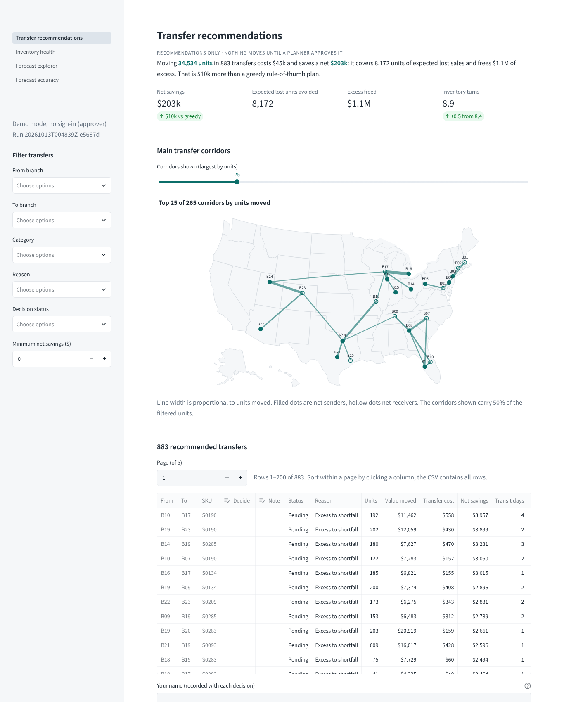
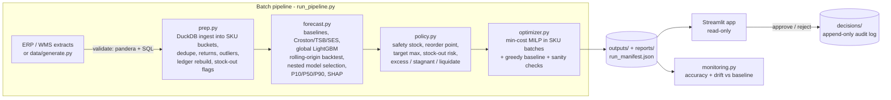
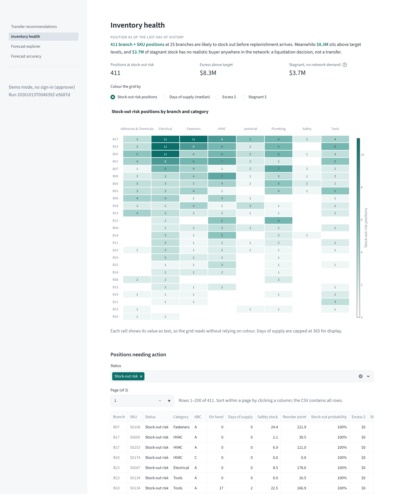
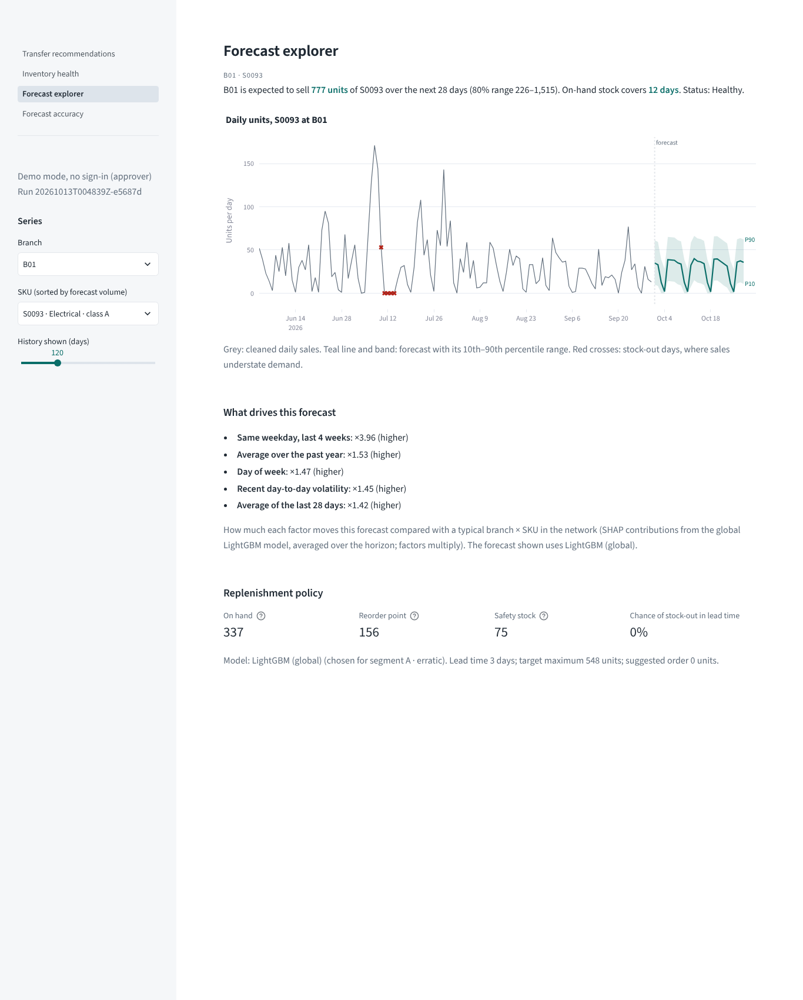
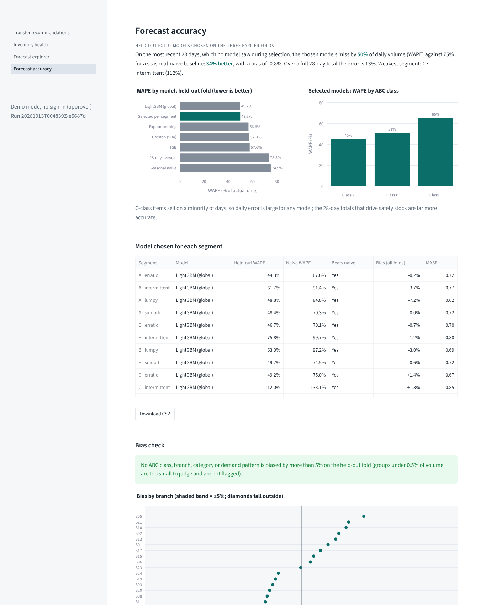

# Stockflow

**Branch-level SKU demand forecasting and inventory rebalancing for a multi-branch distributor.**

A distributor with 25 branches and 300 SKUs holds about $13M of stock. Some branches are
about to run out of items that sit idle a few hundred miles away. Stockflow forecasts
demand for every branch × SKU, turns the forecast into safety stock and reorder points,
and recommends which units to move where at minimum total cost. A planner approves or
rejects each move.

> All data is **synthetic** (generated by `data/generate.py`), built to behave like a real
> ERP/WMS extract, data-quality problems included. See [Connecting real data](#connecting-real-data).



## Results

Base network: 25 branches, 300 SKUs, 4,889 branch × SKU series, three years of daily history.

**Inventory position on the planning date** ($13.4M on hand):
- 411 positions are likely to stock out before replenishment arrives.
- $8.3M sits above target levels.
- $3.7M is stagnant stock of SKUs the whole network cannot sell within a year. That is flagged for liquidation, because no transfer can fix it.

**Forecast**, measured on a 28-day period no model saw during model selection:

| Model | Daily WAPE | Bias | MASE |
|---|---|---|---|
| Selected per segment (mostly the global LightGBM) | **49.8%** | −0.8% | 0.72 |
| Seasonal naive | 74.9% | +1.2% | 0.96 |

- The selected models are 34% more accurate than seasonal naive, and better in every segment that has demand.
- Over a full 28-day total, error falls to 12.9% (A items 12.0%).
- No branch, category or ABC class is biased by more than 5%.
- The P10–P90 band contains 84% of actuals, against an 80% target.

**Transfers**: 883 recommended moves of 34.5k units.

| Measure | Optimiser (MILP) | Greedy baseline |
|---|---|---|
| Net savings | **$203k** | $193k |
| Transfer cost | $45k | $47k |
| Expected lost-sales units avoided | 8,172 of 9,725 | 8,296 |
| Excess inventory freed | $1.14M | $1.05M |
| Annual carrying cost of excess | $2.18M → $1.92M | $2.18M → $1.93M |
| Inventory turns | 8.4 → 8.9 | 8.4 → 8.9 |

**Robustness:** re-solving with one assumption changed (service level 90/98%, transfer cost ×0.5/×2, forecast error σ ×0.75/×1.5, forecast level ±10%) keeps 66–92% of the same moves, and net savings stay between $171k and $235k.

**Scale:** at 10x (250 branches, 3,000 SKUs, ~490k series) the pipeline completes on a 4-core, 15 GB machine.
- Held-out WAPE is 50.8%.
- The optimiser solves 163 parallel batches to optimality in 13 minutes, saving $42.8M vs $40.6M greedy.

Timings are in [AUDIT.md](AUDIT.md).

## How it works



1. **Data and cleaning** (`data/generate.py`, `src/prep.py`).
   - Three years of daily demand with weekday, annual-by-category, holiday, promotion, trend and lifecycle effects. It runs through an (s, S) replenishment simulation with deliberately biased planners, so stock-outs and excess emerge naturally.
   - Cleaning removes duplicates and returns, imputes outage days from *past* weeks only, and caps keying errors.
   - It rebuilds the daily stock ledger from transactions, reconciled to weekly counts, and flags stock-out days, whose sales understate demand.
   - Assumptions A1–A9 are documented in `src/prep.py`. Against the generator's ground truth, outlier detection is 99.6% precise, and stock-out flags cover 99.2% of lost-sales units.
2. **Forecasting** (`src/features.py`, `src/models.py`, `src/forecast.py`).
   - Candidate models: seasonal naive, a 28-day average, Croston-SBA, TSB, and weekday-adjusted exponential smoothing.
   - A single global LightGBM (Tweedie) model uses lags of 7/14/28/364/365 days, rolling means, standard deviations and demand frequency, calendar, holiday, promotion and price features, and branch/SKU attributes. It forecasts recursively, 28 days ahead.
   - Evaluation is a 4-fold rolling-origin backtest. The best model per segment (ABC class × Syntetos-Boylan pattern) is chosen on folds 1–3 and reported on fold 4.
   - Intervals scale each series' error by the per-segment quantiles of its standardised residuals.
3. **Inventory policy** (`src/policy.py`). Lead-time σ comes from weekly-block backtest errors, which capture error autocorrelation.
   - Safety stock = z(service level) × σ.
   - Reorder point = lead-time demand + safety stock.
   - Target max = lead time + review period of demand + safety stock.
   - Each position is marked with its stock-out probability and expected lost units, and classified as healthy, excess, stagnant (90+ days unsold) or liquidate.
4. **Rebalancing** (`src/optimizer.py`). The MILP (PuLP + HiGHS) minimises transfer cost + expected stock-out cost + holding and obsolescence cost of the excess left behind.
   - Constraints: senders stay at or above their reorder point (never below safety stock), receivers stay within target and storage capacity, a minimum transfer size, a maximum transit time, and an optional same-region rule.
   - Every recommendation carries a cost, projected savings, a reason code and a plain-language reason.
   - A greedy rule-of-thumb is the baseline.

## Quick start

```bash
git clone https://github.com/bbbiyeba/stockflow && cd stockflow
pip install -r requirements.txt          # Python 3.11+
make run                                 # ~5 min: generate, clean, forecast, policy, optimise
make app                                 # dashboard on http://localhost:8501
```

| Command | What it does |
|---|---|
| `make test` | Unit and integration tests with coverage |
| `make check` | Lint, type check, tests and security scans, as in CI |
| `make sensitivity` | Re-solve under alternative assumptions |
| `make scale-test` | Profile the 10x network |
| `make monitor ACTUALS=new_sales.csv` | Check live accuracy and drift |
| `make eda` | Re-execute the EDA notebook |

Or with Docker: `docker build -t stockflow . && docker run --rm -p 8501:8501 stockflow`.

## The dashboard

| Page | Answers |
|---|---|
| **Transfer recommendations** | What should move where, what it saves, how robust the plan is. Approve or reject each transfer. |
| **Inventory health** | Which branches and categories are at stock-out risk, overstocked, stagnant or need liquidation. |
| **Forecast explorer** | History, 28-day forecast with its 80% range, what drives it, and the replenishment policy for any branch × SKU. |
| **Forecast accuracy** | Held-out accuracy by model and segment, bias by branch, category and class, and interval coverage. |

| Inventory health | Forecast explorer | Forecast accuracy |
|---|---|---|
|  |  |  |

Access and safety settings (all optional, see `.env.example` and [SECURITY.md](SECURITY.md)):

| Variable | Effect |
|---|---|
| `STOCKFLOW_REQUIRE_LOGIN=1` | Require OIDC sign-in |
| `STOCKFLOW_APPROVERS` | Who may approve transfers |
| `STOCKFLOW_MASK_FINANCIALS=1` | Hide all $ values for demos |
| `STOCKFLOW_DEMO_APPROVALS=1` | Let an unauthenticated local user record decisions (demo only) |

## Repository layout

```
config.yaml            every business rule and model setting
configs/scale_10x.yaml load-test profile (250 branches, 3,000 SKUs)
data/generate.py       synthetic ERP/WMS extracts
src/prep.py            ingest, validation, cleaning, ledger rebuild
src/features.py        feature engineering (leakage-tested)
src/models.py          baselines and intermittent-demand models
src/forecast.py        backtest, selection, intervals, cold start, SHAP
src/policy.py          safety stock, reorder points, health flags
src/optimizer.py       MILP + greedy baseline + sanity checks
src/monitoring.py      live accuracy and drift checks
src/dashboard.py       dashboard pages (app.py is the entry point)
src/validation.py      data contracts       src/runlog.py   logging + run manifest
src/decisions.py       approval audit log   src/access.py   roles and sign-in
notebooks/01_eda.ipynb exploratory analysis
scripts/               profiling and sensitivity analysis
tests/                 unit, integration and dashboard tests
docs/                  monitoring plan, data contract, screenshots
```

## Assumptions and limitations

- **Synthetic data.** Absolute numbers (savings, WAPE) describe this simulated network, not any real company. The value is in the method and its relative comparisons.
- **Lost sales are not recovered.** Stock-out days are excluded from training rather than un-censored, so demand at chronically short branches may still be slightly understated.
- **Normal error model** for safety stock and stock-out probability. It is reasonable for 28-day and lead-time totals, and crude for very slow movers.
- **Prediction intervals over-cover** (about 84% of actuals inside P10–P90, against 80%). Conservative, and safety stock does not depend on them.
- **The optimiser plans one cycle.** It looks at today's positions and the next lead time and review period, not a multi-period schedule. Capacity is in units, not cube.
- **Economics are configurable estimates:** stock-out cost = 0.6 × unit cost, plus holding and obsolescence rates. Agree them with finance before trusting dollar figures.
- **Pruning trades a little optimality for scale:** each node keeps its 8 cheapest lanes, which costs 0.8% of savings at 1x.
- **Inventory turns** are measured on projected inventory after one replenishment cycle, because transfers move stock rather than remove it. The gain comes from purchases the DC no longer needs to make.

## Connecting real data

Produce the seven extracts described in [docs/DATA_CONTRACT.md](docs/DATA_CONTRACT.md),
point `paths.raw_dir` at them, and run `python run_pipeline.py --skip-generate`. Every
file is validated on the way in, and a contract violation stops the run with a readable
message. Agree the cost settings in `config.yaml` → `optimizer` with finance and planning,
and enable sign-in before loading real numbers. See [SECURITY.md](SECURITY.md) and
[docs/MONITORING.md](docs/MONITORING.md) for operating the pipeline.

## Quality

| Check | Result |
|---|---|
| Tests | 62 passing at 94% coverage: unit tests, a leakage guard, optimiser constraint checks, an end-to-end run on a tiny multi-bucket network, malformed-input rejection, and a render of every dashboard page |
| Lint, format, types | ruff, black and mypy clean |
| Security | bandit and pip-audit clean (0 issues, 0 known vulnerabilities) |
| CI | GitHub Actions runs all of the above on every push |

An audit of the first version (UI, security, scale, data-science correctness,
reliability, production readiness) and everything it changed is in [AUDIT.md](AUDIT.md).
